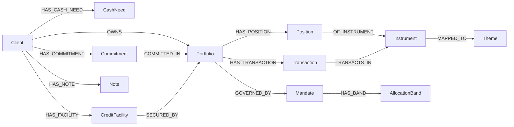

# AURUM ontology and Neo4j knowledge graph

AURUM models the challenge dataset as a typed, temporal property graph. The
executable ontology is `src/singhacks26/ontology.py`: every relationship has an
explicit domain and range. This is a Neo4j ontology contract, not OWL inference.
It supports the existing RM workflow without moving financial rules into the graph.

## Setup

Use Neo4j 5.26 or later (Community, Desktop or Aura). Create a database dedicated
to AURUM and configure these values in your local, untracked `.env`:

```dotenv
NEO4J_URI=bolt://localhost:7687
NEO4J_USERNAME=neo4j
NEO4J_PASSWORD=your-local-password
NEO4J_DATABASE=neo4j
```

For Aura use its supplied `neo4j+s://...` URI.
Use the database name supplied by your instance; it may differ from `neo4j`.
Secure `neo4j+s` and `bolt+s` connections use the operating system's trusted
certificate store via `truststore`, retaining certificate and hostname validation.
This supports locally trusted certificate authorities without disabling TLS checks.
Credentials remain server-side. The graph can contain synthetic client names and original RM notes. Configure
a local server if those records must stay on the machine. The censored AI fact
packet boundary remains separate from this graph. No LLM sees graph credentials.

```powershell
uv sync --python 3.13 --group dev
uv run --python 3.13 streamlit run app.py
```

Open **Knowledge graph**, select **Import current dataset**, then select a client
and snapshot and click **Explore client**. Nothing connects to or writes to Neo4j
on app startup. Import requires schema and write privileges; exploration uses
parameterised, fixed read queries. A missing connection does not affect other pages.

## Model and semantics



- Client and portfolio IDs preserve the source household/account distinction.
- A position is identified by **portfolio + instrument + snapshot date**. Dates
  are source ISO strings. Valuation dates remain separate, preserving stale marks.
- Mandate bands have **mandate + asset class** identities. Custody portfolios have
  no `GOVERNED_BY` edge. A graph edge is not a suitability determination.
- Cash needs preserve amount, currency, due window and certainty. Facilities
  retain their dated source columns; importing them does not calculate LTV.
- Underlying references remain the instrument master's exact text. They are not
  split into invented securities or weighted exposures.
- Notes carry `assertion_kind=rm_observation`, source note ID and original date.
  Theme mappings carry `assertion_kind=curated_mapping` and reference the existing
  `CURATED_THEMES` map. Neither implies verified causation.
- Events and market observations are independently queryable nodes. Events use
  date/type/description identities; market observations use series/date identities.
  There are deliberately no inferred event-to-client edges. The controlled event
  log remains authoritative; live news is not imported into it.
- Source rows retain their original fields plus file and **1-based data-record
  number**, excluding the header. This is not a physical line claim for multiline CSV.
  Relationships retain the source record or curated mapping that establishes them.

## Integrity and import behaviour

The importer validates relationship domains/ranges, duplicate identities, position
ownership and missing foreign keys before writing. Unresolved references block
import rather than silently removing evidence. Neo4j uniqueness constraints cover
all `AurumEntity.uid` values and the single `AurumCatalog.name` pointer.

Each projection gets a content hash covering nodes, relationships and ontology
version. Database identities include that hash. All nodes, relationships and the
active-version pointer are written in one managed transaction. Reimporting the
same source merges the same entities and edges. Changed sources create a new
version; old versions remain available. Queries select the active version and
require an explicit holdings date. No unrelated database entities are deleted.
Source tables must be passed in their original CSV order for record provenance.

Version retention is deliberate for this prototype; repeated source edits consume
storage. There is no automatic retention policy, bank authentication, live source
sync, graph-based recommendation engine, or automatic ingestion of workflow edits.
The graph explorer uses a 500-edge display cap. The positions query is not capped.

## Example: shared theme exposure across a household

Run this read query in Neo4j Browser after importing (change the client/date):

```cypher
MATCH (catalog:AurumCatalog {name: 'aurum'})
MATCH (c:AurumEntity:Client {client_id: 'CL-0014'})-[:OWNS]->(p:Portfolio)
      -[:HAS_POSITION]->(h:Position)-[:OF_INSTRUMENT]->(i:Instrument)
      -[:MAPPED_TO]->(t:Theme)
WHERE c.version = catalog.active_version AND h.snapshot_date = '2026-08-26'
RETURN t.name AS theme, sum(h.market_value_usd) AS value_usd,
       collect(DISTINCT p.portfolio_id) AS portfolios,
       collect(DISTINCT h.source) AS evidence
ORDER BY value_usd DESC
```

Themes overlap; totals across themes must not be added together. These are full
position values for mapped instruments, not estimated underlying basket weights.

## Checks

```powershell
uv run --python 3.13 --group dev pytest
```

Offline tests check source coverage, ontology edges, custody, missing references,
identity collisions, content hashes and household totals for all five snapshots.
To exercise the real driver, constraints, repeated imports and date-filtered
queries, use a **dedicated test database** with the connection variables above:

```powershell
$env:AURUM_NEO4J_TEST = '1'
uv run --python 3.13 --group dev pytest tests/test_knowledge_graph.py
```

This test writes versioned synthetic data and changes that database's active
AURUM projection. It is skipped unless explicitly enabled.
